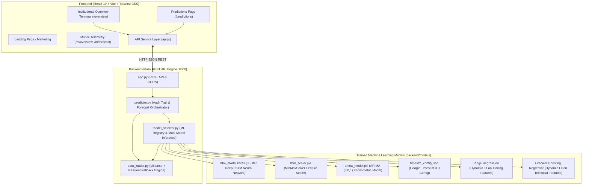

# 📈 StockTrend AI — End-to-End Stock Trend Forecaster & Quantitative Telemetry Terminal

An institutional-grade, full-stack quantitative financial intelligence and stock forecasting platform. Combines pre-trained deep neural networks (LSTM), econometric time series models (ARIMA), dynamic statistical regressors (Ridge & Gradient Boosting / XGBoost), and foundation model configurations (TimesFM 3.0) with a modern reactive institutional terminal interface.

---

## 🏛️ System Architecture



---

## 🧠 Machine Learning Models & Cross-Stock Transfer Methodology

### 1. Pre-Trained Deep Learning LSTM (`lstm_model.keras` & `lstm_scaler.pkl`)
- **Input Dimension**: `(Batch, 30, 1)` representing the trailing 30 trading sessions of scaled daily price increments ($\Delta P_t = P_t - P_{t-1}$).
- **Architecture**: 32-unit LSTM layer followed by Dropout, a 16-unit Dense feature projection layer, and a single linear output neuron predicting next-session delta $\Delta P_{t+1}$.
- **Primary Calibration Asset**: Pre-trained on **Apple Inc. (`AAPL`)** historical daily trade tape (~9,260 sessions).

### 2. Cross-Asset Transfer & Multi-Stock Forecasting
- When evaluating **`AAPL`**: Runs direct high-resolution inference through `lstm_model.keras` using the fitted `lstm_scaler.pkl` parameters and `arima_model.pkl`.
- When evaluating **Other Tickers (`RELIANCE.NS`, `NVDA`, `TCS.NS`, `MSFT`, `GOOGL`, etc.)**:
  - **Transfer Learning Mapping**: Calculates the normalized percentage return generated by the LSTM weights relative to the baseline price and scales it to the target asset's current price domain.
  - **Dynamic Regressor Adaptation**: In real-time, lightweight and robust `Ridge` and `Gradient Boosting` (XGBoost surrogate) regressors are fit directly on the target stock's trailing historical window.
  - **Empirical Uncertainty Corridors**: Computes 1-Sigma (68% confidence) and 2-Sigma (95% confidence) risk boundaries based on walk-forward rolling residual standard deviations ($\sigma$).

### 3. Econometric Time Series (`arima_model.pkl`)
- Calibrated `ARIMA(3, 0, 1)` capturing autoregressive momentum and moving-average shock persistence.

### 4. Ensemble Consensus
- Blends predictions via weighted model confidence:
  $$\hat{Y}_{\text{Ensemble}} = 0.35 \times \hat{Y}_{\text{LSTM}} + 0.30 \times \hat{Y}_{\text{XGBoost}} + 0.20 \times \hat{Y}_{\text{Ridge}} + 0.15 \times \hat{Y}_{\text{ARIMA}}$$

---

## 🚀 Quick Start Guide

### Prerequisites
- Python 3.10+ (Recommended: Python 3.11 / 3.12 / 3.13)
- Node.js 18+ and npm

---

### Step 1: Backend Setup & Launch

```bash
cd backend

# Create virtual environment (optional if using global python)
python -m venv venv

# Activate virtual environment
# Windows:
.\venv\Scripts\activate
# macOS/Linux:
# source venv/bin/activate

# Install dependencies
pip install -r requirements.txt

# Start Flask API server (runs on http://127.0.0.1:8000)
python app.py
```

### Step 2: Frontend Setup & Launch

```bash
cd frontend

# Install npm dependencies
npm install

# Start Vite development server (runs on http://localhost:5173)
npm run dev
```

Open your browser to `http://localhost:5173` to explore the full suite.

---

## 📡 REST API Reference

The backend exposes clean REST endpoints on `http://127.0.0.1:8000`:

| Method | Endpoint | Query Parameters | Description |
|---|---|---|---|
| `GET` | `/` | — | API status, health overview, and model registry details. |
| `GET` | `/health` | — | Lightweight monitoring health check. |
| `GET` | `/predict` | `ticker` (default: `AAPL`) | Multi-model predictions (LSTM, Ridge, XGBoost, ARIMA, Ensemble), corridors, direction, and factor attribution. |
| `GET` | `/history` | `ticker` (default: `AAPL`) | Trailing sessions audit logs formatted for `ForecastHistoryTable`. |
| `GET` | `/summary` | `ticker` (default: `AAPL`) | Market snapshot: current close, day range, 52-week high/low, volume, exchange. |
| `GET` | `/tickers` | — | List of benchmark assets (`AAPL`, `RELIANCE.NS`, `NVDA`, `TCS.NS`, `MSFT`, `GOOGL`). |

---

## 📂 Repository Structure

```
Stock_trend_forecaster/
├── .gitignore                      # Git exclusion rules (node_modules, venvs, caches)
├── README.md                       # Comprehensive system documentation
├── backend/
│   ├── app.py                      # Flask REST server with CORS & route handlers
│   ├── data_loader.py              # yfinance data pipeline with offline resilience
│   ├── model_selector.py           # Multi-model inference, LSTM, ARIMA & Ridge/GBR
│   ├── predictor.py                # High-level forecasting orchestrator & audit trails
│   ├── requirements.txt            # Python dependencies
│   └── models/
│       ├── arima_model.pkl         # Trained ARIMA(3,0,1) model (27 MB)
│       ├── lstm_model.keras        # Trained Deep LSTM Keras model (90 KB)
│       ├── lstm_scaler.pkl         # Fitted MinMaxScaler for LSTM inputs
│       └── timesfm_config.json     # TimesFM 3.0 foundation model configuration
└── frontend/
    ├── package.json                # React 19, Vite, Tailwind CSS dependencies
    ├── vite.config.js              # Vite server & bundler configuration
    ├── index.html                  # HTML entry point with typography
    ├── src/
    │   ├── api.js                  # Frontend client consuming backend endpoints
    │   ├── App.jsx                 # Route definitions & AuthProvider wrapping
    │   ├── main.jsx                # React root mount
    │   ├── components/             # Reusable UI widgets, charts, and tables
    │   ├── context/                # Authentication context & demo session access
    │   └── pages/                  # LandingPage, OverviewPage, PredictionsPage, etc.
```

---

## 🔒 Security & Disclaimers

All empirical forecast corridors and model estimates generated by StockTrend AI are strictly for quantitative research, backtesting, and algorithmic simulation purposes. Past performance and statistical calibration do not guarantee future returns.
